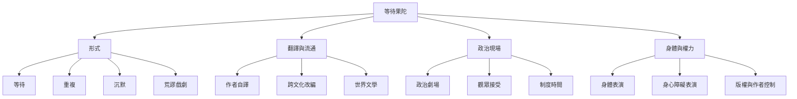

本書的核心問題是：當約定的對象始終不出現，人們如何以等待、重複、語言、身體與彼此依存，繼續組織生活？《等待果陀》既是一部二十世紀劇作，也是一個可被不同歷史現場反覆使用的舞台結構。

五張專題地圖：[[MOC｜劇作結構與形式美學]]、[[MOC｜翻譯與跨文化流通]]、[[MOC｜全球演出與政治現場]]、[[MOC｜身體、性別與權力]]、[[MOC｜研究方法與延伸實踐]]。

核心概念：[[荒謬戲劇]]、[[等待]]、[[重複]]、[[沉默]]、[[時間性]]、[[存在主義]]、[[荒謬]]、[[作者自譯]]、[[文本生成史]]、[[手稿研究]]、[[戲中戲]]、[[身體表演]]、[[舞台語言]]、[[政治劇場]]、[[觀眾接受]]、[[種族化荒謬]]、[[監獄劇場]]、[[身心障礙表演]]、[[跨文化改編]]、[[世界文學]]、[[版權與作者控制]]、[[制度時間]]。
