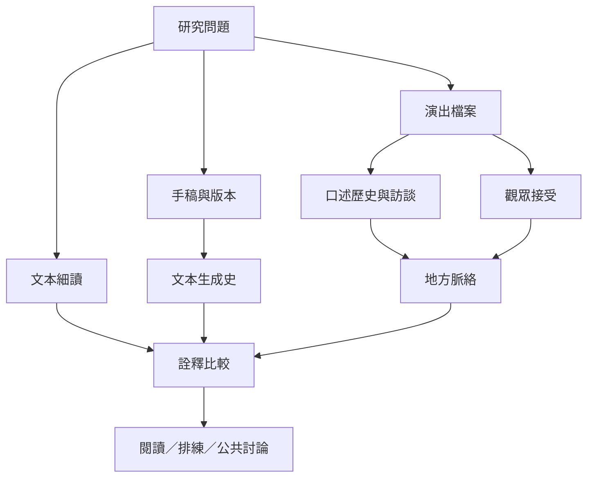

這張概念地圖將作品研究的材料與方法連結起來：文本細讀、版本學、手稿研究、口述史、演出接受史、跨文化比較與參與式實踐。研究時先判斷資料屬於第一手演出紀錄、參與者回憶、學術論文還是評論文章，再決定能支持什麼結論。

概念入口：[[文本生成史]]、[[手稿研究]]、[[觀眾接受]]、[[跨文化改編]]、[[世界文學]]、[[政治劇場]]。

研究入口：[[全球貝克特研究社群提供書目期刊與研究網絡入口]]、[[手稿研究揭示等待果陀並非一次完成的固定文本]]、[[政治演出的見證應納入當地工作者的聲音]]。

實踐提案：[[把等待果陀讀書會設計成一次等待時間的共同實驗]]、[[以法文英文中文三種版本做一次微型翻譯實驗]]、[[建立一張全球等待果陀演出地圖並標示地方脈絡]]、[[用等候現場訪談比較不同制度如何分配時間]]。

延伸到 [[MOC｜劇作結構與形式美學]]。
