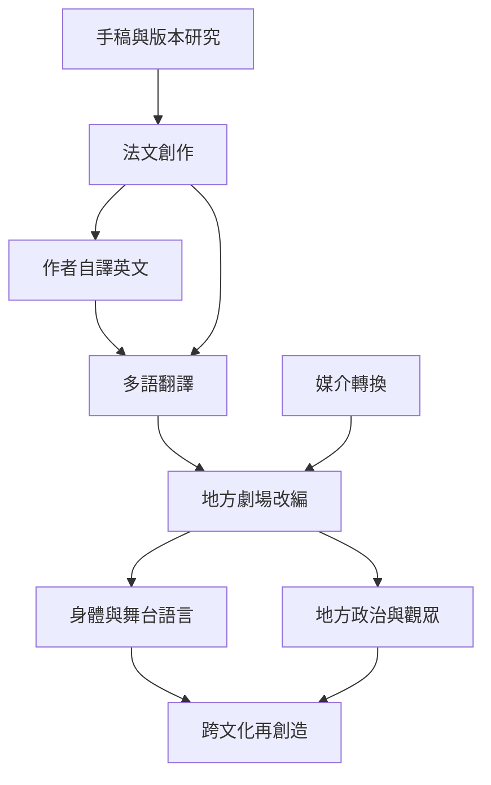

本圖整理《等待果陀》如何從法文創作、自譯英語到世界各地翻譯與改編。作品的跨文化生命不只是台詞換語言，也包含身體、聲音、表演傳統、媒介和觀眾結構的變化。建議先讀 [[作者自譯使法文與英文版成為兩個彼此對話的文本]]、[[翻譯不只是詞語替換而是把劇場語言重新編排]] 和 [[世界文學的流通不是單向輸出而是多點再創造]]。

概念入口：[[作者自譯]]、[[文本生成史]]、[[手稿研究]]、[[舞台語言]]、[[身體表演]]、[[跨文化改編]]、[[世界文學]]、[[觀眾接受]]。

地區案例：[[印度多語翻譯使戈多進入不同區域的文化與政治語境]]、[[土耳其的演出史說明非西方語境並未阻止貝克特被持續演出]]、[[日本演出以舞踏與身體空間拓展貝克特的劇場語言]]、[[台灣當代傳奇劇場以京劇身段重寫等待果陀的喜劇失敗]]、[[中國疫情期間的線上演出讓等待果陀進入虛擬公共空間]]。

延伸到 [[MOC｜劇作結構與形式美學]] 與 [[MOC｜全球演出與政治現場]]。
