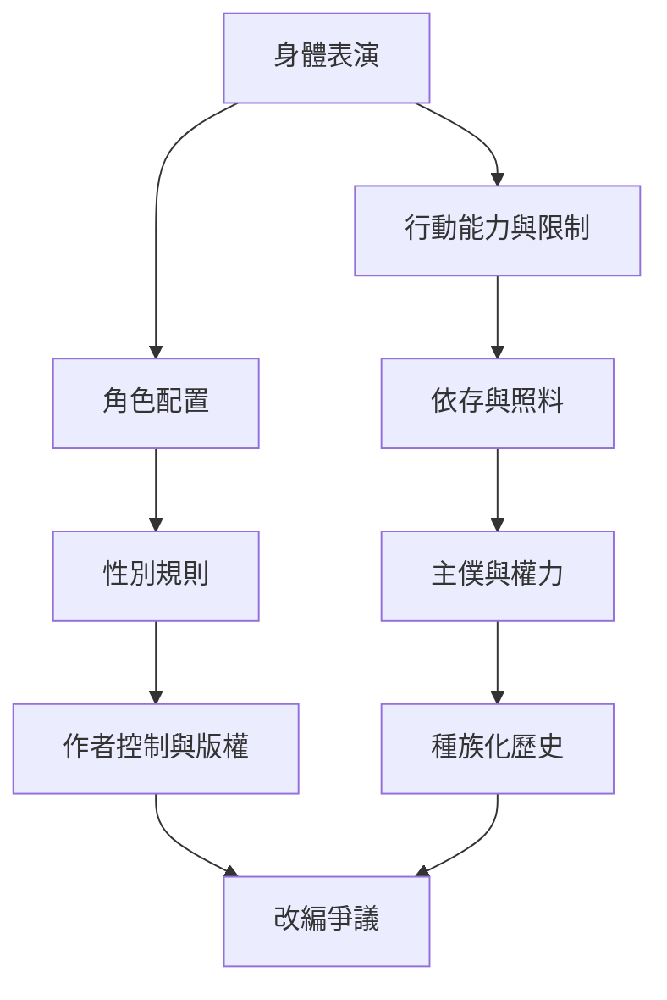

本圖聚焦演員身體、角色性別、行動能力與角色間權力。波卓與幸運兒的繩索、主僕關係、人物的疲憊與移動困難，以及女性與非二元演員的演出限制，都使舞台形式和制度權力交織。閱讀時應區分文本規定、演出慣例、法律權利與倫理評價。

概念入口：[[身體表演]]、[[舞台語言]]、[[身心障礙表演]]、[[政治劇場]]、[[版權與作者控制]]、[[種族化荒謬]]、[[制度時間]]。

研究材料：[[身心障礙表演研究讓等待果陀中的身體依存重新可見]]、[[戈多是女人的演出爭議揭示作者控制與表演權的張力]]、[[2026年中國改編研究把女性角色與城市空間帶入經典再詮釋]]。

延伸到 [[MOC｜全球演出與政治現場]] 與 [[MOC｜翻譯與跨文化流通]]。
