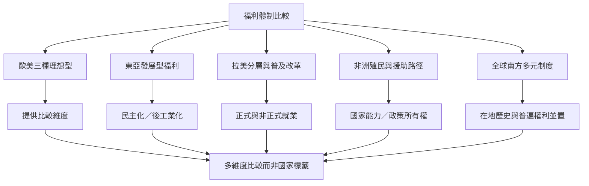

福利國家比較需要同時看共通理論與區域歷史。此圖將歐美制度理論連到東亞發展主義、拉美職業分層、非洲殖民脈絡及全球南方的多路徑發展。

## 關係圖

## 深入閱讀
* [[三種福利體制提供比較框架但不能當成國家標籤]]、[[福利制度的分類應比較政策維度而非固定貼國家標籤]]。
* [[東亞福利國家由發展主義走向民主化與後工業化再調整]]、[[拉美福利制度在普及性慷慨程度與公平之間呈現分化]]。
* [[非洲社會保障制度深受殖民歷史與國際援助軌跡形塑]]、[[全球南方福利制度不能以歐美工業國歷史作為唯一模型]]。
