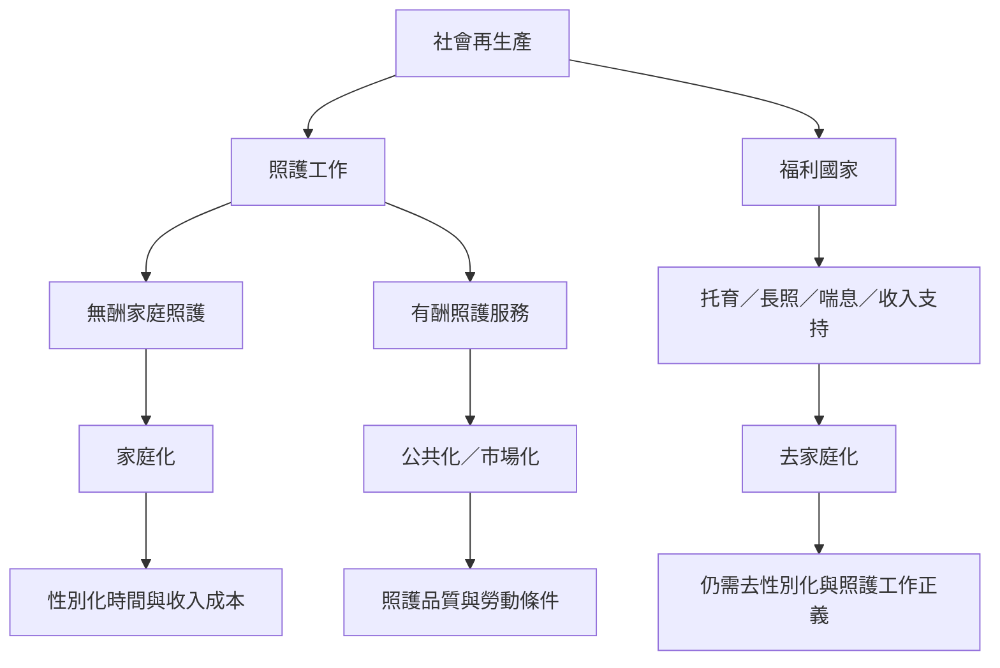

照護是社會得以延續的基礎工作。此圖呈現國家、家庭與市場如何分配照護責任，以及去家庭化後仍須處理的勞動條件與性別問題。

## 關係圖

## 深入閱讀
* [[女性主義研究指出福利體制依賴未被計價的照護勞動]]、[[家庭化福利把照護責任轉嫁給家庭尤其女性]]。
* [[去家庭化不能自動消除照護中的性別不平等]]、[[福利國家須把照護視為基礎公共基建]]。
* 概念入口：[[社會再生產 Social_reproduction]]、[[照護經濟 Care_economy]]、[[去家庭化 Defamilialization]]。
