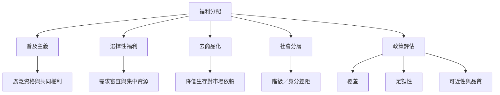

福利制度不只分配資源，也會界定誰值得受助、誰承擔成本，以及差異如何被合理化。此圖串接普及／選擇、去商品化、分層、覆蓋與足額性。

## 關係圖

## 深入閱讀
* [[福利制度應以去商品化程度衡量個人退出市場的能力]]、[[福利國家也會再製階級與身分分層]]。
* [[普及主義與選擇性救助各自伴隨不同治理代價]]、[[社會保障底線必須同時確保覆蓋與足額性]]。
* 概念入口：[[去商品化 Decommodification]]、[[普及主義 Universalism]]、[[選擇性福利 Selectivity_(welfare)]]、[[社會支出 Social_expenditure]]。
