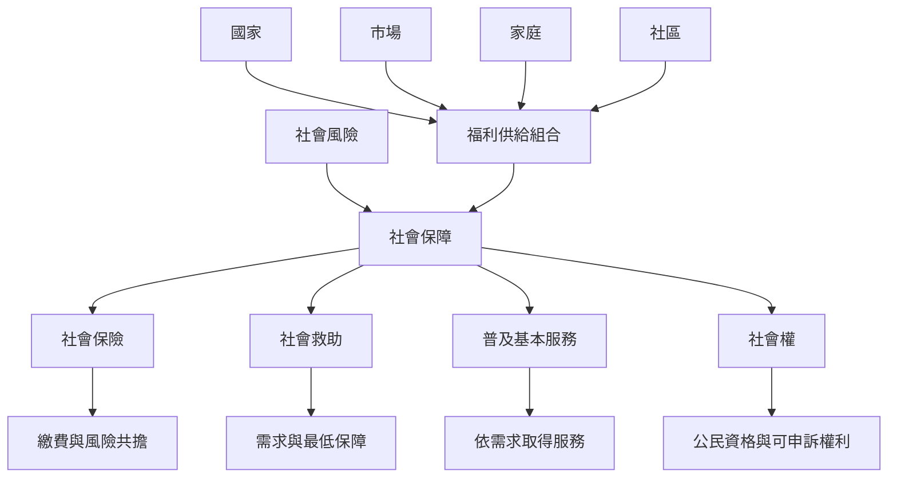

福利國家是制度組合，不是單一給付計畫。此圖從社會風險出發，連到權利、制度工具、福利供給者與結果評估。

## 關係圖

## 深入閱讀
* [[福利國家是分擔社會風險的制度組合]]、[[國家市場家庭社區共同生產社會福利]]、[[社會權讓保障從慈善救濟轉為公民資格]]。
* [[社會保險與社會救助需要互補而非二選一]]、[[福利制度應保障不工作期間也能過有尊嚴生活]]。
* 概念入口：[[福利國家 Welfare_state]]、[[社會保障 Social_security]]、[[社會權 Social_rights]]、[[社會保險 Social_insurance]]、[[社會救助 Social_assistance]]。
