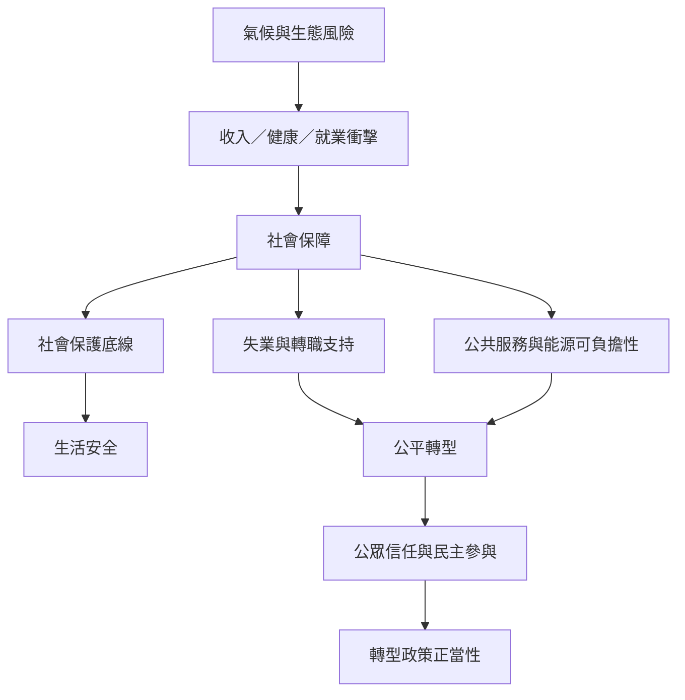

福利制度必須回應新的環境風險與產業轉型。此圖將社會保障底線連結到氣候調適、減碳、勞動轉型及民主正當性。

## 關係圖

## 深入閱讀
* [[生態福利國家需同時保障生活安全與減碳轉型]]、[[綠色轉型的成本不能由弱勢勞工與低收入家庭單獨承擔]]。
* [[將氣候轉型基金設計為普遍保障與在地民主工具]]、[[全球社會保障仍有龐大保障缺口且氣候轉型擴大風險]]。
* 概念入口：[[公平轉型 Just_transition]]、[[社會保護底線 Social_protection_floor]]、[[社會保障 Social_security]]。
