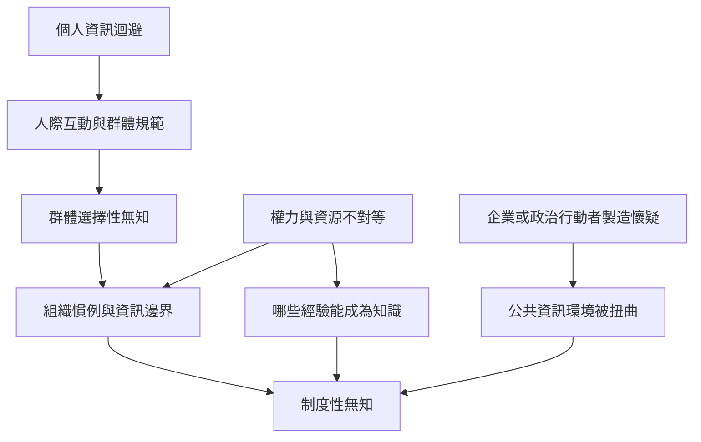

個人的資訊迴避可能由情緒、自我形象或群體身份驅動；當組織流程與利益結構讓這種迴避反覆發生時，它可能轉化為集體或制度性無知。這張圖將不同層次連起來，並指出企業製造懷疑與知識制度排除也會塑造資訊環境。

可從[[資訊迴避有時保護自我形象卻也削弱他人利益]]理解個人機制，再讀[[群體認同會把選擇性無知制度化]]、[[組織無知由流程與誘因共同維持]]與[[製造懷疑比直接否定證據更能維持制度性無知]]。權力面向則由[[權力會影響哪些經驗能成為知識]]補足。

## 參考
* [[組織中的故意無知是一個動態過程]]
* [[種族支配能製造系統性的白人無知]]
* [[女性性知識遭壓抑顯示無知具有性別政治]]
* [[無知學]]
* [[無知學]]、[[制度性無知]]、[[白人無知]]
* 本書脈絡：[[Willful_ignorance]]。
