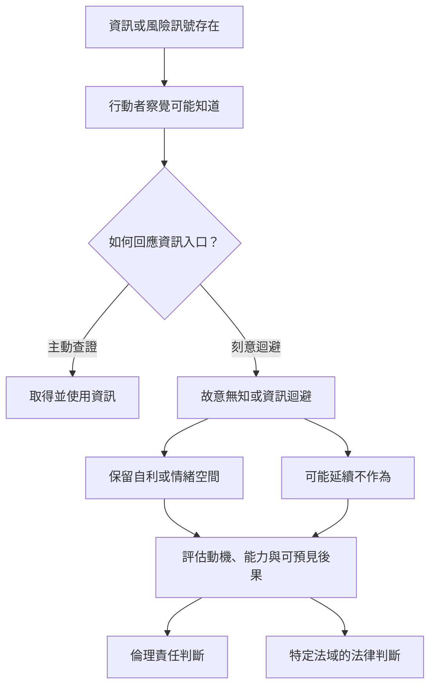

故意無知不是單一心理狀態，而是資訊可得性、行動者察覺、迴避行動與後續責任互相連動的過程。這張概念地圖從個人層次整理資訊入口如何被選擇，以及何時可能構成可歸責的蓄意盲視。

理解此圖時，先讀[[故意無知不是無知本身而是對知識入口的管理]]與[[故意無知可以拆解為可觀察的四段機制]]，再比較[[道德責任也包含對知識入口的選擇]]和[[蓄意盲視]]。需注意，法律判斷有其特定要件，不能直接由心理學描述推出。

## 參考
* [[人們會主動選擇不知道而非單純缺乏資訊]]
* [[法律以高度可能性與故意迴避界定蓄意盲視]]
* [[道德責任的歸因取決於人們如何理解故意無知]]
* [[故意無知]]、[[刻意不知]]、[[蓄意盲視]]
* 本書脈絡：[[Willful_ignorance]]。
