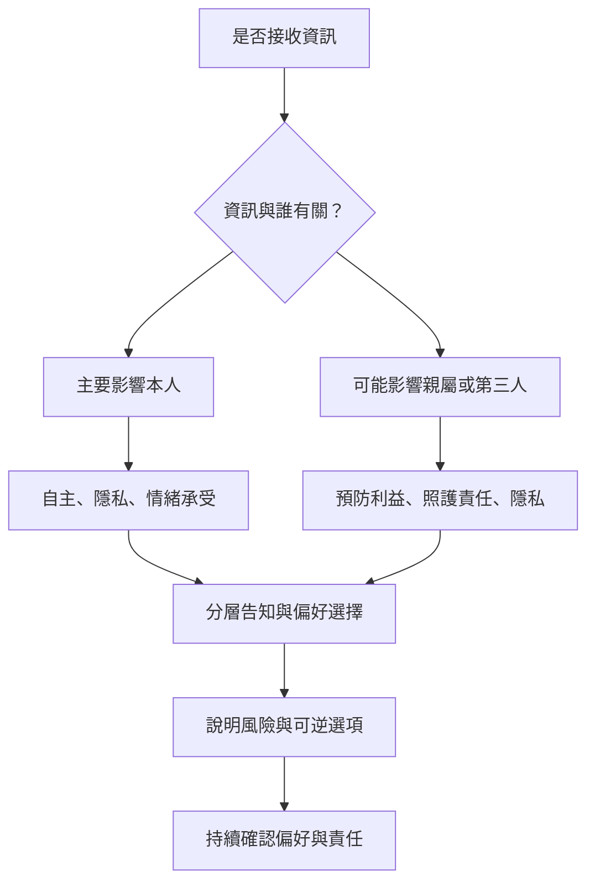

倫理治理不應把所有資訊揭露視為善，也不應讓「我不知道」成為逃避後果的通行證。關鍵是評估資訊對當事人的自主、他人利益、可行行動與風險的關係，並建立可被問責的程序。基因資訊提供了不知情選擇可能正當、卻仍涉及親屬利益的清楚案例。

先讀[[善意不知與逃避責任必須依功能及後果區分]]，再看[[不知情權必須放進關係與後果中衡量]]與[[知識正義需要建立可被問責的查證流程]]。這個框架適用於醫療、個人資料與公共決策，但每個領域仍需依具體法規與專業倫理調整。

## 參考
* [[基因資訊中的不知情選擇涉及自主與親屬利益]]
* [[資訊迴避有時保護個人但也可能造成傷害]]
* [[道德責任也包含對知識入口的選擇]]
* [[刻意不知]]、[[不知情權]]
* 本書脈絡：[[Willful_ignorance]]。
