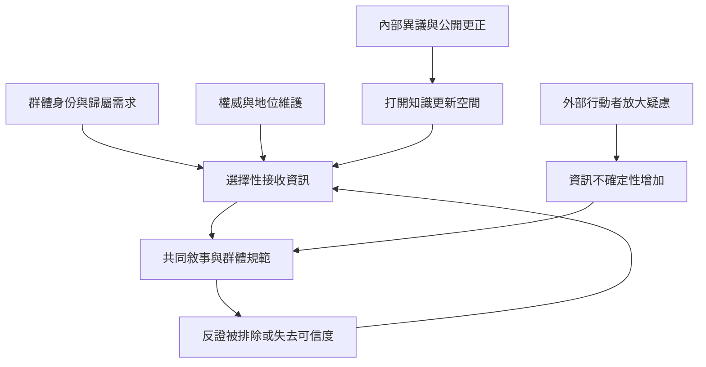

群體可能透過共同身份、忠誠規範與媒體環境排除不利資訊；有資源的行動者也可能策略性地放大不確定性，使群體更容易忽略反證。這張圖將身份防衛與公共資訊操控並列，指出兩者可能互相強化，但不把所有群體分歧都當成故意無知。

此圖與[[群體認同會把選擇性無知制度化]]、[[製造懷疑比直接否定證據更能維持制度性無知]]互相呼應；改善方向可參考[[設計不羞辱人的反資訊迴避對話]]與[[讓群體保有改變看法而不失去歸屬的空間]]。

## 參考
* [[群體認同會使資訊迴避成為集體常態]]
* [[企業能透過製造懷疑延長科學爭議]]
* [[道德責任的歸因取決於人們如何理解故意無知]]
* [[動機性推理]]、[[認知不正義]]、[[無知學]]
* 本書脈絡：[[Willful_ignorance]]。
