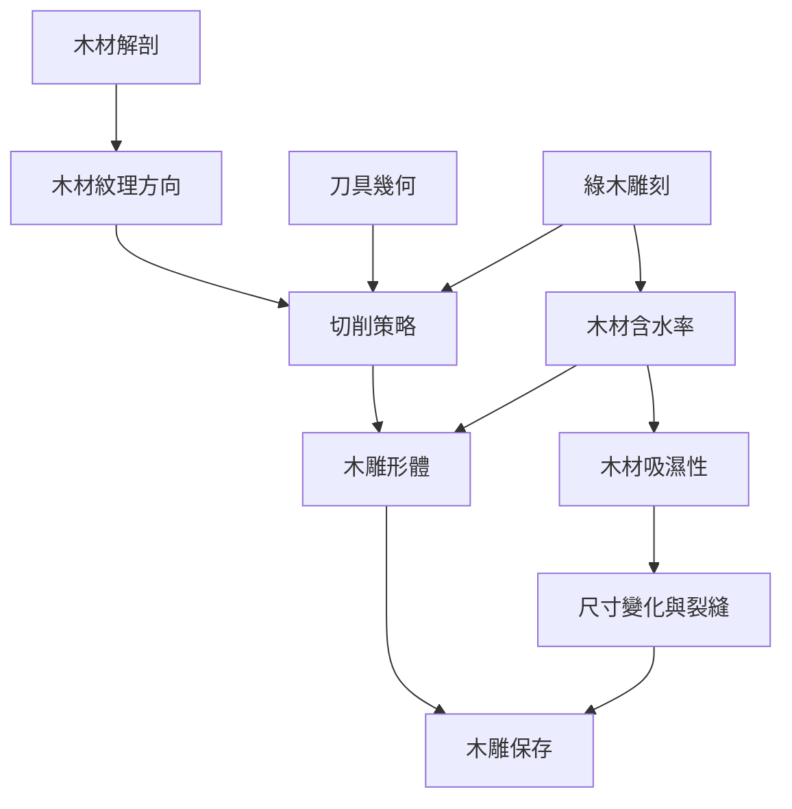

木雕的材料決策從木材解剖與含水狀態出發，經由木紋方向、工具幾何與切削策略，最後影響作品的穩定度與保存。這張地圖把木材的物理性質與雕刻者的操作決策放在同一條流程中。

概念延伸：[[木雕首先是讀懂木材而不是把圖案刻進木頭]]、[[木材紋理方向是雕刻設計的一部分]]、[[綠木雕刻讓材料狀態成為設計的一部分]]、[[木雕保存首先要管理環境而不是急著填補裂縫]]。

---

[[Wood_carving]]
