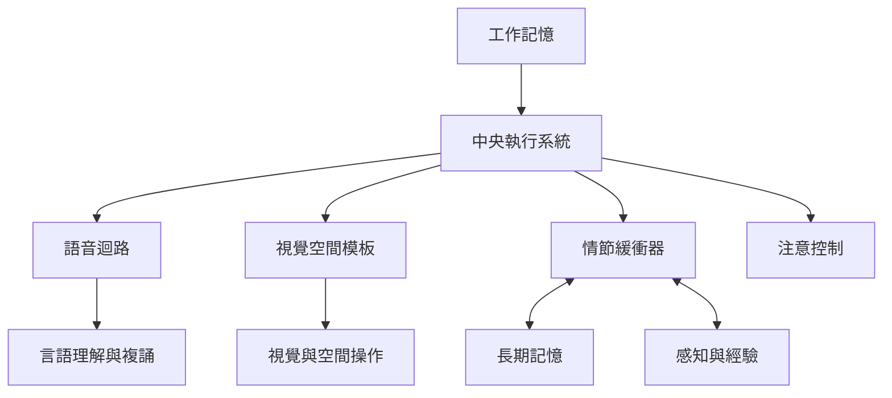

工作記憶可以從多成分架構理解：中央執行系統調度注意，語音迴路與視覺空間模板維持部分不同的材料，情節緩衝器整合跨模態與長期記憶資訊。這是一套功能模型，不是腦區解剖圖。它適合用來分析語言理解、心算、閱讀、計畫與雙重作業中的不同需求。

這張圖應與[[工作記憶不是短期記憶的同義詞，而是當下認知活動的工作空間]]和[[語音與視覺空間材料可由部分不同的工作記憶機制維持]]一起閱讀。模型會隨證據修訂，可參考[[data/工作記憶模型把暫存與注意控制拆成可互動的多個成分]]及[[data/情節緩衝器補足語言視覺與長期記憶的整合問題]]。

這張地圖中的關鍵概念包括[[工作記憶]]、[[中央執行系統]]、[[語音迴路]]、[[視覺空間模板]]、[[情節緩衝器]]、[[長期記憶]]、[[注意控制]]。
## 思與行
* 用這張圖分析一個具體任務，例如聽指令同時走路：哪些資訊需維持，哪些需要控制，哪些要整合？
* 不將圖中各區塊理解成互不相干或各自只由單一腦區負責。
