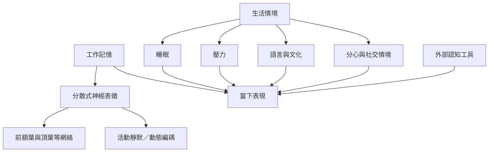

工作記憶的腦機制是分散式、動態的，不只由前額葉單獨儲存。當下表現也受到睡眠、壓力、文化背景、測驗語言、環境分心和外部工具影響。研究需要把實驗室表現與真實日常功能接起來。

可從[[工作記憶的神經表徵分布於多個腦區並隨任務動態變化]]與[[工作記憶表現是注意控制、短暫維持與更新共同形成的結果]]理解，再用[[工作記憶測驗分數不能單獨代表日常功能或個人價值]]連結真實情境。來源包括[[data/工作記憶的神經維持不必總是依靠持續放電]]與[[data/日常情境測量能補足實驗室工作記憶測驗的生態效度]]。

這張地圖中的關鍵概念包括[[工作記憶]]、[[分散式神經表徵]]、[[活動靜默工作記憶]]、[[前額葉皮質]]、[[睡眠]]、[[急性壓力]]、[[生態效度]]、[[認知卸載]]。
## 思與行
* 觀察認知表現時同時記錄狀態與環境條件，並採取適當外部支持。
