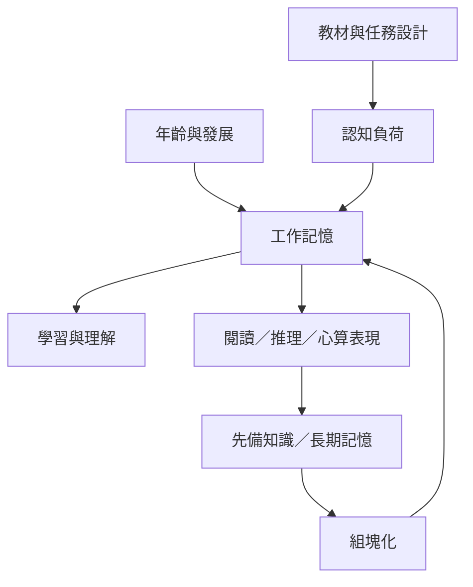

工作記憶支援閱讀、語言理解、心算、問題解決和學習新知。長期知識能形成組塊，降低新手處理零散資訊的需求；兒童工作記憶會發展，但不同任務成分的軌跡不同。教學上應降低無關負荷，逐步建立先備知識，並避免將單一分數當成學習能力的總結。

相關永久筆記包括[[長期知識能透過組塊化降低工作記憶的實際負擔]]、[[工作記憶發展具有年齡與任務雙重差異]]和[[教學應減少與學習目標無關的工作記憶負荷]]。研究來源見[[data/兒童工作記憶在成長期間上升，但不同任務呈現不同軌跡]]。

這張地圖中的關鍵概念包括[[工作記憶發展]]、[[工作記憶]]、[[組塊化]]、[[認知負荷]]、[[長期記憶]]、[[更新]]。
## 思與行
* 在教學與自學中先建立概念組塊，然後才增加同時操作的內容。
