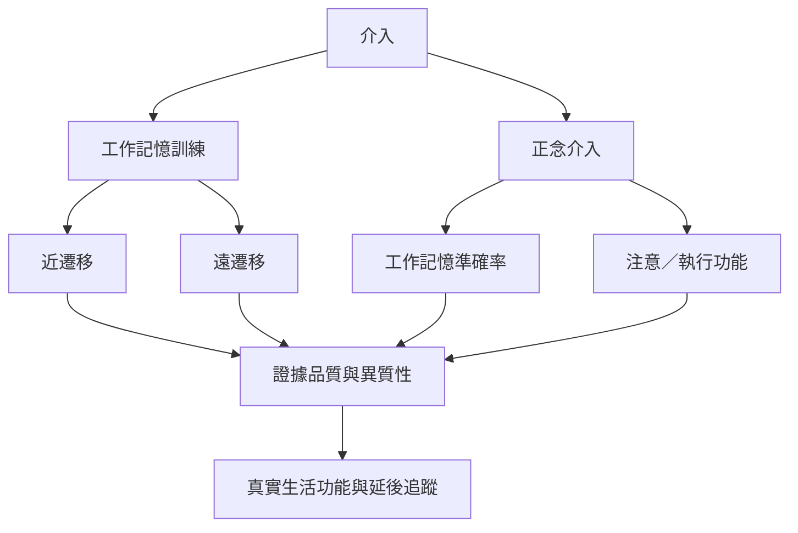

工作記憶訓練與正念介入都常被宣稱可以改善認知，但評估時必須分開檢查研究對象、控制組、測量指標、追蹤時間與遷移範圍。特定訓練任務的進步，不等於通用能力或生活表現的廣泛提升；正念研究也呈現不同統合分析與不同認知指標間的差異。

閱讀順序可先看[[工作記憶訓練的價值要看能否遷移到真正關心的任務]]，再讀[[正念對工作記憶的影響應以謹慎而可檢驗的語言表達]]。相關文獻包括[[data/工作記憶訓練較可靠的效果是近遷移而非廣泛遠遷移]]與[[data/正念介入對工作記憶的效果會隨研究設計與分析範圍而異]]。

這張地圖中的關鍵概念包括[[工作記憶訓練]]、[[近遷移]]、[[遠遷移]]、[[正念]]、[[工作記憶準確率]]、[[生態效度]]。
## 思與行
* 把成效定義為對真實目標有幫助，不以研究者或產品宣稱取代可檢驗的結果。
