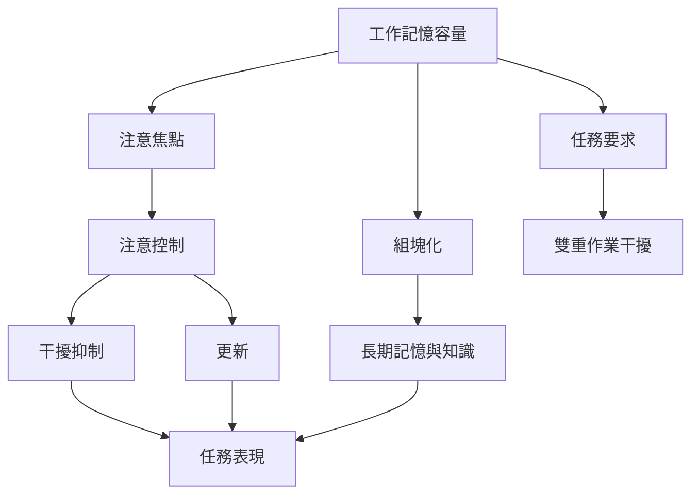

容量限制不是固定數量的簡單容器模型，而是由注意焦點、組塊化、干擾抑制、更新和任務規則共同決定。Cowan 的容量研究、Oberauer 的注意理論與 Baddeley 的多成分模型，提供不同層次的解釋，彼此有重疊也有理論分歧。

概念上可由[[工作記憶容量不是固定的物件數，而是任務與表徵共同決定的上限]]進入，再閱讀[[工作記憶表現是注意控制、短暫維持與更新共同形成的結果]]。理論依據包括[[data/工作記憶的核心容量通常比七個項目更接近三至五個組塊]]和[[data/工作記憶與注意力的關係不能簡化成單一資源模型]]。

這張地圖中的關鍵概念包括[[工作記憶容量]]、[[注意焦點]]、[[注意控制]]、[[組塊化]]、[[更新]]、[[干擾抑制]]、[[雙重作業干擾]]。
## 思與行
* 分析分心、忘記步驟或多工失誤時，分別檢查焦點、更新、干擾與任務複雜度。
