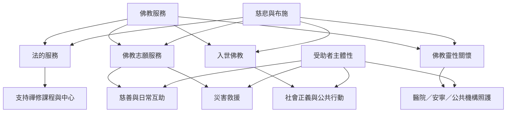

本圖比較不同佛教服務型態。它們可能共享慈悲、布施與減苦的倫理語言，但服務目的、對象、權限與治理模式並不相同。

重要概念：[[佛教志願服務]]、[[入世佛教]]、[[佛教靈性關懷]]、[[慈悲]]、[[布施]]、[[受助者主體性]]、[[比較研究]]。

重要比較：[[不同佛教服務模式不能被視為同一種制度]]、[[修行與社會參與不必被設定為二選一]]。

### 參考
- [[亞洲入世佛教研究把社會服務放進多元歷史與政治脈絡]]
- [[Sallie King 將社會參與視為佛教靈性實踐的一種形式]]
- [[佛教靈性關懷研究把慈悲傾聽帶入醫院與公共機構]]
- [[台灣花蓮地震研究顯示日常志工網絡能轉化為災害應變能力]]
