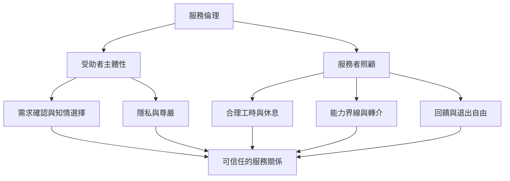

本圖整理服務倫理的雙向責任。服務對象需要被尊重、理解與允許拒絕；服務者也需要合理工作量、訓練、休息、界線與支持。兩者並非競爭，而是互相依賴。

重要概念：[[慈悲]]、[[受助者主體性]]、[[服務者照顧]]、[[照顧勞動]]、[[倦怠]]、[[戒]]。

核心命題：[[慈悲服務必須從受助者需求開始]]、[[無我不等於抹除服務者的需要]]、[[中心規範同時是修習環境與組織治理工具]]。

### 參考
- [[佛教靈性關懷研究把慈悲傾聽帶入醫院與公共機構]]
- [[台灣花蓮地震研究顯示日常志工網絡能轉化為災害應變能力]]
- [[2025 年泰國研究以訪談探討佛教教導如何支持志願工作]]
