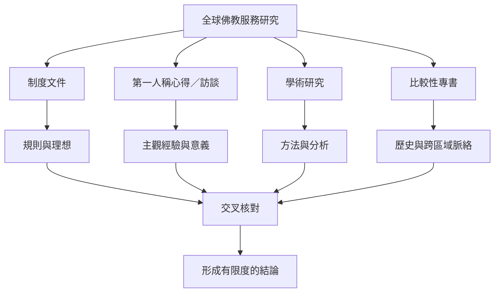

全球比較時，資料常有不均：葛印卡法務官方指引和服務心得較容易取得；學術研究則較多集中在亞洲特定佛教組織；一些地區的志工經驗、退出者故事與受助者觀點仍少。要建立較全面的知識庫，必須區分一手文件、個人敘事、學術研究與出版書籍。

重要概念：[[比較研究]]、[[研究方法]]、[[佛教志願服務]]、[[入世佛教]]、[[法的服務]]。

地區材料包括：[[台灣花蓮地震研究顯示日常志工網絡能轉化為災害應變能力]]、[[中國佛教志願服務研究指出慈悲實踐也會形塑助人者的自我理解]]、[[泰國志工僧研究提出目標、服務、傳法與反思的工作循環]]、[[Dhamma Padhana 的長課服務者記錄了慈心與無常的學習]]。

### 參考
- [[Rahmani 的研究提醒葛印卡內觀運動具有獨特的宗教與世俗定位]]
- [[亞洲入世佛教研究把社會服務放進多元歷史與政治脈絡]]
- [[第一人稱心得能呈現意義但不能代表整體經驗]]
