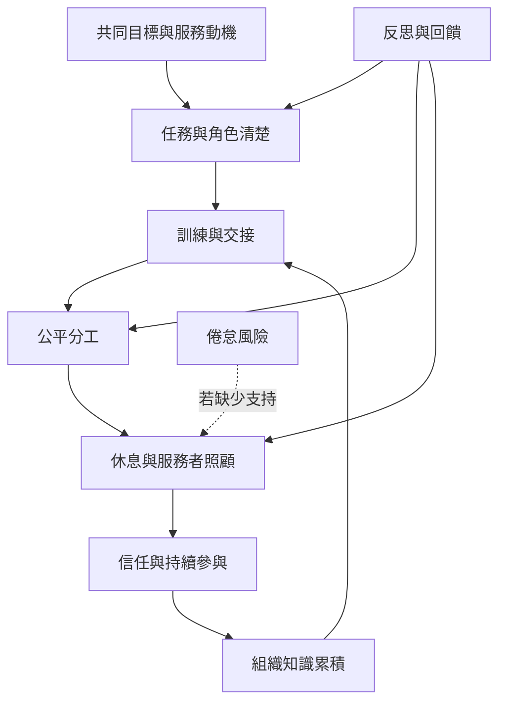

本圖呈現志願服務的可持續條件。個人動機只是起點；團隊還需要共同目標、訓練、互惠、角色清楚、休息、照顧與回饋機制。

重要概念：[[志願服務]]、[[志願組織]]、[[社會資本]]、[[互惠]]、[[無償勞動]]、[[照顧勞動]]、[[情緒勞動]]、[[倦怠]]、[[服務者照顧]]。

核心命題：[[可持續的服務必須把休息設計進工作系統]]、[[無償勞動仍需要被看見與公平分配]]、[[志願服務依賴互惠與社會資本而非單純個人熱情]]。

### 參考
- [[長課服務心得指出高密度團隊合作也需要輪休安排]]
- [[泰國志工僧網絡研究指出共同願景與互惠有助於協作]]
- [[澳洲 Dhamma Bhumi 的中心介紹顯示課程依賴舊生志願協作]]
