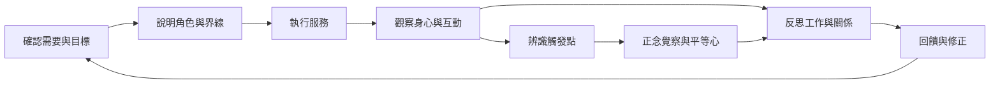

服務不會自動變成修行或學習；需要把經驗轉化成可回看的觀察、判斷與調整。本圖把服務流程與反思性實踐連起來。

重要概念：[[反思性實踐]]、[[正念覺察]]、[[平等心]]、[[研究方法]]、[[服務評估]]。

核心命題：[[服務需要從善意轉化為可反思的工作流程]]、[[服務把禪修從坐墊延伸到人際互動]]、[[第一人稱心得能呈現意義但不能代表整體經驗]]。

### 參考
- [[泰國志工僧研究提出目標、服務、傳法與反思的工作循環]]
- [[葛印卡指出服務者在協助學員時也持續接受訓練]]
- [[佛教智慧型禪修的系統性回顧檢視親社會行為的研究證據]]
