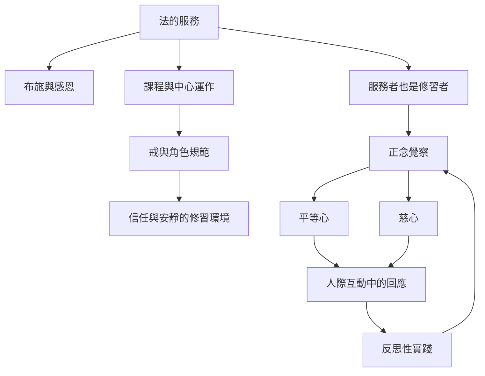

本圖聚焦葛印卡傳統的法務實踐：服務者在協助課程與維持中心運作時，也在工作與人際關係中練習覺察、慈心和平等心。服務不只是一份工作，也是一個由規則、團隊、休息與反思共同構成的修習場。

重要概念：[[法的服務]]、[[布施]]、[[正念覺察]]、[[平等心]]、[[慈心]]、[[戒]]、[[反思性實踐]]、[[無我]]。

相關論證：[[服務把禪修從坐墊延伸到人際互動]]、[[服務者同時也是修習者]]、[[平等心能在工作情境中被觀察而不只是抽象理想]]、[[服務讓慈心在團隊協作中具體化]]。

### 參考
- [[葛印卡傳統把法的服務定位為修行與利他的結合]]
- [[葛印卡指出服務者在協助學員時也持續接受訓練]]
- [[加拿大服務者文集呈現服務如何讓內觀回到人際互動]]
