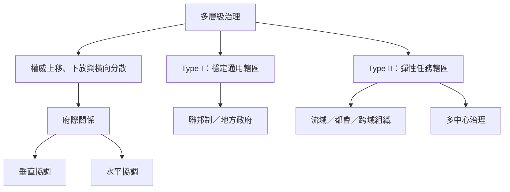

多層級治理的理論核心，是把治理理解為跨越不同領土層級、功能機構與社會行動者的權力配置。這張地圖從 Type I / Type II 的制度類型，連到多中心治理、分權與府際關係。

## 概念連結
* [[term/多層級治理]]、[[term/I型治理]]、[[term/II型治理]]
* [[term/聯邦制]]、[[term/分權]]、[[term/權力下放]]、[[term/府際關係]]
* [[term/多中心治理]]、[[term/垂直協調]]、[[term/水平協調]]

## 延伸閱讀
* [[data/多層級治理透過權威上移下放與橫向分散改變中央國家的邊界]]
* [[data/多層級治理包含穩定的通用轄區與彈性的任務型轄區]]
* [[data/多層級治理同時面臨概念經驗與民主正當性的挑戰]]
* [[note/多層級治理不是多幾層官僚而是重新組織權力關係]]
