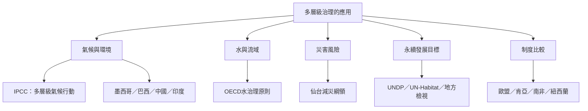

多層級治理會隨政策領域與國家制度而呈現不同樣貌。氣候、流域、災害與永續發展需要跨尺度整合；歐盟、拉丁美洲、亞洲、非洲與紐西蘭案例則呈現不同的地方自主、垂直管理、合作治理與共同治理安排。

## 概念連結
* [[term/地方化（SDG localization）]]、[[term/多中心治理]]、[[term/協力治理]]
* [[note/跨區域合作能補足都會區與流域治理的行政碎片化]]
* [[note/危機治理需要多層級分工與持續回饋而非單向命令]]
* [[idea/建立臺灣流域治理的跨鄉鎮協作協議與共同資料]]

## 跨國案例連結
* [[data/歐盟多層級治理以夥伴關係輔助性與共同責任為基礎]]
* [[data/墨西哥氣候治理顯示州級政策能力與地方執行資源並不對等]]
* [[data/印度智慧城市專案顯示特殊目的機構可能繞過地方民主機制]]
* [[data/巴西地方環境治理能力與制度採納和組織建置高度相關]]
* [[data/中國環境治理改革顯示垂直監督可降低地方保護但可能改變權力配置]]
* [[data/肯亞憲法把國家與郡政府界定為相互依存的兩個治理層級]]
* [[data/南非合作治理把政府部門間的互依性寫入憲政制度]]
* [[data/紐西蘭旺格努伊河協議把原住民族關係納入共同治理架構]]
