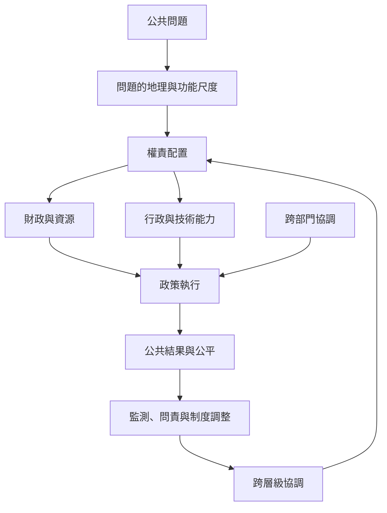

制度是否有效，不只取決於權力被放在哪一層，還取決於任務尺度、財政來源、行政能力、資料與跨部門政策是否相互配合。這張地圖以「問題尺度—權責—資源—能力」串起治理設計的關鍵變項。

## 概念連結
* [[term/輔助性原則]]、[[term/治理尺度錯置]]、[[term/財政分權]]
* [[term/垂直協調]]、[[term/水平協調]]、[[term/跨部門政策一致性]]
* [[note/任務尺度應由問題的地理與功能範圍決定]]
* [[note/分權只有與財政能力和行政能力配套才會形成真實自治]]
* [[note/跨層級協調必須同時處理責任重疊與責任真空]]

## 案例連結
* [[data/墨西哥氣候治理顯示州級政策能力與地方執行資源並不對等]]
* [[data/巴西地方環境治理能力與制度採納和組織建置高度相關]]
* [[data/水治理的失靈常源自七種跨層級協調缺口]]
