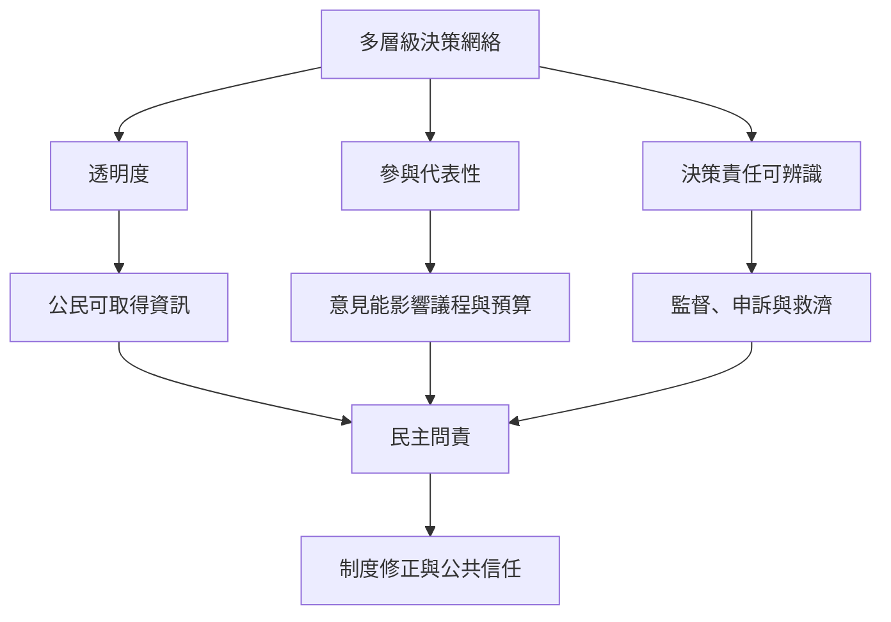

多層級治理的民主考驗在於：權力愈分散，公民是否仍然能辨認決策者、參與政策形成、獲得資訊並追究責任？效率、協作與民主不是自動一致的目標，必須透過透明制度、代表性參與與清楚責任鏈連結。

## 概念連結
* [[term/民主問責]]、[[term/協力治理]]、[[term/網絡治理]]
* [[note/多層級治理的成效不能以政策協調取代民主問責]]
* [[note/參與式治理必須讓居民意見進入實際決策與資源配置]]
* [[note/原住民族共同治理要求承認關係與權利而非只增加諮詢程序]]
* [[note/多層級制度應建立可辨認的決策與責任鏈]]

## 批判性案例
* [[data/多層級網絡可能提升協調效率卻削弱民主可問責性]]
* [[data/印度智慧城市專案顯示特殊目的機構可能繞過地方民主機制]]
* [[data/中國地方政策執行可能以最低限度遵從回應中央命令]]
* [[data/紐西蘭旺格努伊河協議把原住民族關係納入共同治理架構]]
