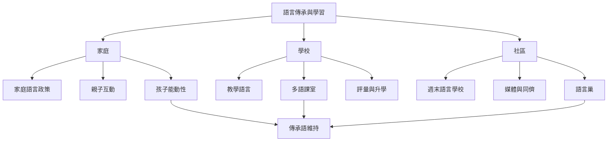

多語教育與家庭語言傳承共同關心語言如何跨越世代與制度。家庭是語言社會化的重要場域，但家庭並非孤立單位；學校、同儕、社區、媒體與國家政策會一起形塑語言能否延續。

## 比較案例
* 菲律賓裔義大利家庭：[[data/移民家庭的語言傳承會受到世代、同儕與社會語言地位影響（菲律賓裔義大利家庭，2024）]]。
* 澳洲華英家庭：[[data/澳洲跨語家庭維持華語需要父母、孩子與社區共同支持（Huang與Liao，2023）]]。
* 拉脫維亞離散家庭：[[data/拉脫維亞離散家庭以日常家庭策略維持傳承語（Martena，2023）]]。
* 南非多語課室：[[data/南非學術課室中的跨語教學有助學生動用完整語言資源（Mbirimi-Hungwe，2023）]]。

## 延伸概念
[[term/家庭語言政策（Family Language Policy）]]、[[term/傳承語（Heritage Language）]]、[[term/語言社會化（Language Socialization）]]、[[term/多語教育（Multilingual Education）]]、[[term/母語為本多語教育（Mother Tongue-Based Multilingual Education）]]、[[term/語言巢（Language Nest）]]。
