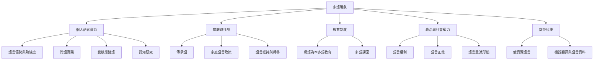

多語現象是一個跨越個人、家庭、社群、制度與科技的知識領域。此地圖以「語言資源如何被習得、調度、承認與傳承」為主線，將社會語言學、教育、認知、語言政策、語言復振與數位技術串連起來。

## 閱讀入口
* 基本定義：[[data/多語現象必須同時從個人與社會層次理解（Cenoz，2013）]]、[[data/多語能力是一組可依情境調度的語言資源（Buschfeld等，2023）]]。
* 整體立場：[[note/多語能力應被理解為不均衡且隨情境變動的語言資源]]、[[note/語言能力的邊界是分析工具而非說話者經驗的固定邊界]]。
* 研究與實作：[[idea/用一張語言生活地圖取代語言能力排行榜]]、[[idea/用城市語言散步觀察誰在公共空間裡被看見]]。

## 延伸概念
[[term/多語主義（Multilingualism）]]、[[term/雙語主義（Bilingualism）]]、[[term/語言資源庫（Linguistic Repertoire）]]、[[term/跨語實踐（Translanguaging）]]、[[term/語言政策（Language Policy）]]、[[term/語言正義（Linguistic Justice）]]、[[term/語言景觀（Linguistic Landscape）]]。
