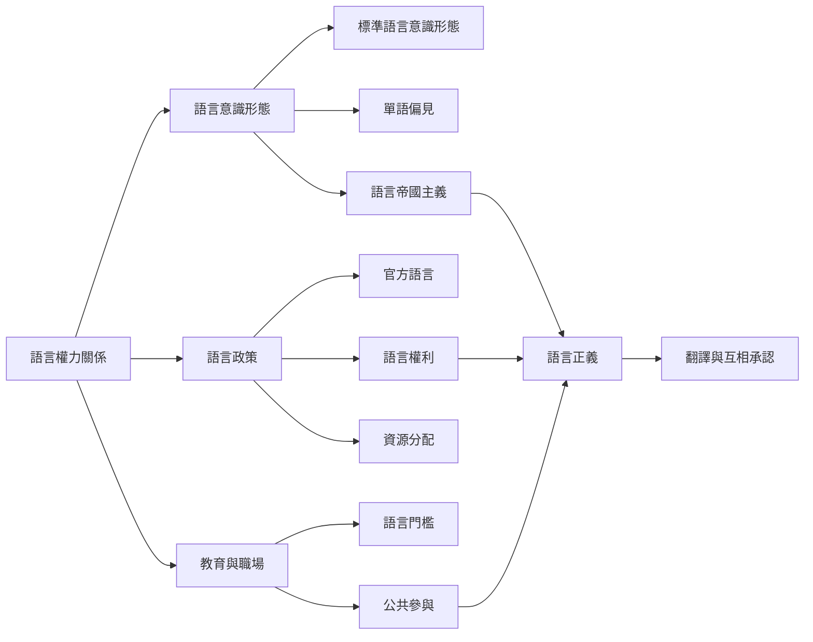

多語社會不是各種語言平等並列的靜態拼圖。語言地位會受到殖民歷史、國家政策、教育市場、勞動條件與科技資源影響。這張地圖聚焦語言如何成為權利、資源、身分與排除機制。

## 核心問題
* 誰能定義「正確」或「專業」的語言？參照[[data/語言正確性標準往往同時複製教育制度中的身分階序（Annual Review，2024）]]。
* 語言權利如何落實為教育與公共服務？參照[[note/語言權利必須轉化為可取得的教育與公共服務]]。
* 多語政策如何處理英語、華語與國家語言之間的張力？參照[[data/台灣語言政策同時把國家語言視為權利與資源並把英語視為資源（2025）]]。

## 延伸概念
[[term/語言正義（Linguistic Justice）]]、[[term/語言權利（Linguistic Rights）]]、[[term/語言帝國主義（Linguistic Imperialism）]]、[[term/語言意識形態（Language Ideology）]]、[[term/標準語言意識形態（Standard Language Ideology）]]、[[term/官方語言（Official Language）]]。
