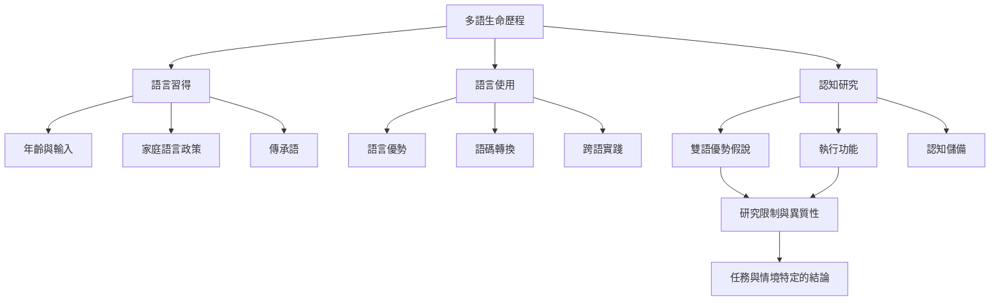

多語習得涉及語言接觸、年齡、輸入、互動、語言優勢與社會情境。認知研究則試圖測量雙語經驗與執行功能、認知儲備等變項的關聯。此地圖的重點是把語言學習的生活價值與特定認知研究的證據分開，避免以單一「雙語優勢」概念概括所有經驗。

## 閱讀提醒
* 先理解語言能力如何分布：[[note/多語能力應被理解為不均衡且隨情境變動的語言資源]]。
* 再看認知研究的設計與爭論：[[data/多語經驗與執行功能的關係取決於任務與研究設計（Lehtonen等，2023）]]、[[data/成人雙語者沒有穩定且普遍的執行功能優勢（Lehtonen等，2018）]]。
* 對失智症議題保持精確：[[note/延後失智症症狀出現不代表雙語能預防失智]]。

## 延伸概念
[[term/雙語主義（Bilingualism）]]、[[term/語言優勢與熟練度（Language Dominance）]]、[[term/語言流失（Language Attrition）]]、[[term/執行功能（Executive Function）]]、[[term/雙語優勢假說（Bilingual Advantage Hypothesis）]]、[[term/認知儲備（Cognitive Reserve）]]。
