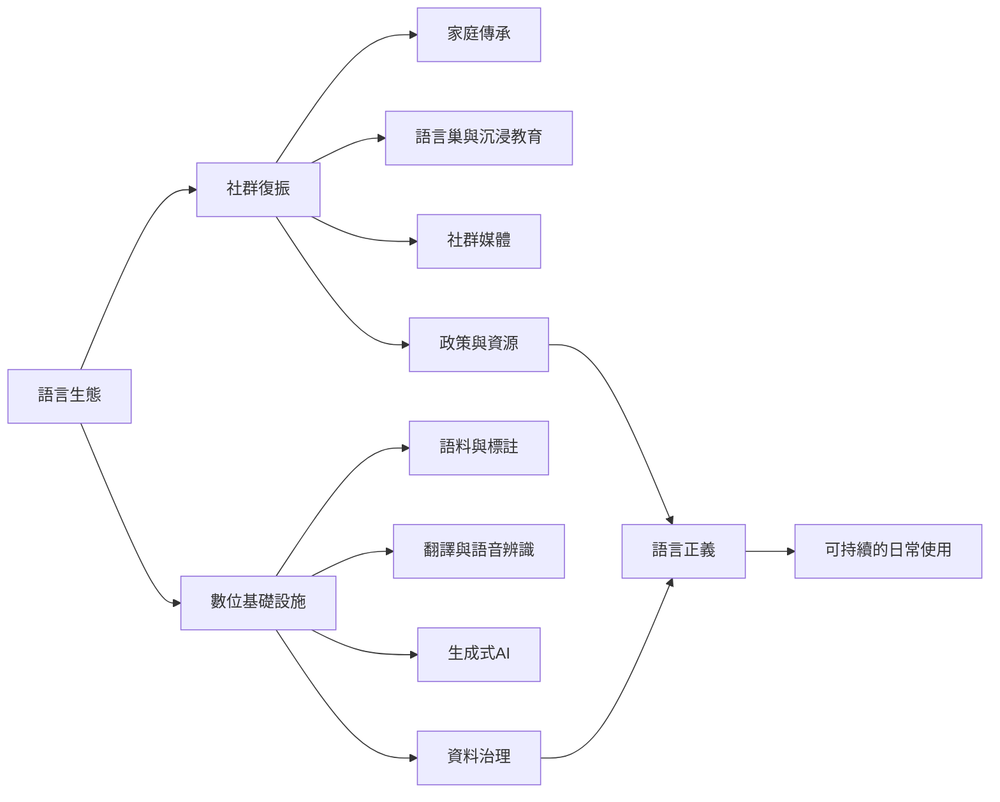

語言復振與數位多語生態的核心問題，是語言能否持續被使用、學習、創作與傳承。數位工具可以擴大語言的可見度與資源，但也會受到資料規模、商業模式與模型標準化影響。復振必須同時處理社群主體性、代間傳承與科技治理。

## 比較案例與閱讀
* 夏威夷語：[復振、媒體與沉浸教育](../data/夏威夷語復振依靠社群、媒體與沉浸教育共同推進（Marlow與Giles，2006）.md)。
* 毛利語：[語言巢與幼兒照顧](../data/毛利語語言巢以幼兒照顧與社群傳承支持復振（Mita，2021）.md)。
* 全球倡議：[[data/原住民族語言復振需要跨世代社群投入而非單次保存（UNESCO，2022至2032）]]。
* 數位治理：[[data/語言科技的普及可能擴大也可能重製語言階序（UNESCO，2025）]]、[[data/AI語言工具可能把商業標準轉化為新的語言規訓（Schneider，2025）]]。

## 延伸概念
[[term/語言復振（Language Revitalization）]]、[[term/語言維持（Language Maintenance）]]、[[term/低資源語言（Low-Resource Language）]]、[[term/語言景觀（Linguistic Landscape）]]、[[term/翻譯（Translation）]]。
