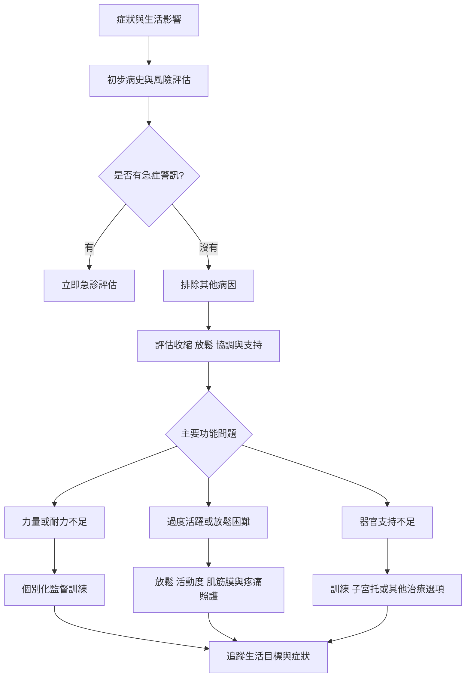

骨盆底功能障礙是一組功能與症狀的集合，不是單一病因。症狀可能涉及尿液、糞便、器官支持、性功能與疼痛；因此評估需要先辨識症狀類型、排除其他原因，再決定訓練、行為治療、物理治療、器具或醫療處置。

此地圖連結[[骨盆底功能應先被評估再決定訓練方向]]、[[凱格爾運動不是所有骨盆底問題的通用解法]]、[[肌肉過度活躍也會造成骨盆底功能失調]]與[[骨盆底照護必須先排除需要緊急處理的神經症狀]]。

概念入口：[[骨盆底功能障礙]]、[[尿失禁]]、[[骨盆器官脫垂]]、[[肛門失禁]]、[[排便協調障礙]]、[[肌肉過度活躍]]、[[肌筋膜疼痛]]、[[生物回饋]]。
