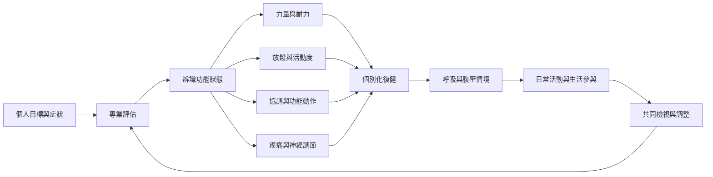

復健計畫需從個人功能狀態與生活目標出發。骨盆底肌訓練可能涵蓋收縮、耐力、放鬆、協調與功能性動作；呼吸、腹內壓管理、疼痛教育、行為策略與社會支持也可能成為照護的一部分。

這張圖將[[骨盆底肌訓練]]放回整體生活功能中，也連結[[身體覺察能協助辨識骨盆底的收縮放鬆與情境反應]]、[[患者的生活目標應成為復健計畫的共同座標]]與[[將日常動作視為骨盆底功能的觀察實驗室]]。

概念入口：[[骨盆底肌訓練]]、[[凱格爾運動]]、[[肌肉過度活躍]]、[[生物回饋]]、[[內感受]]、[[腹內壓]]。
