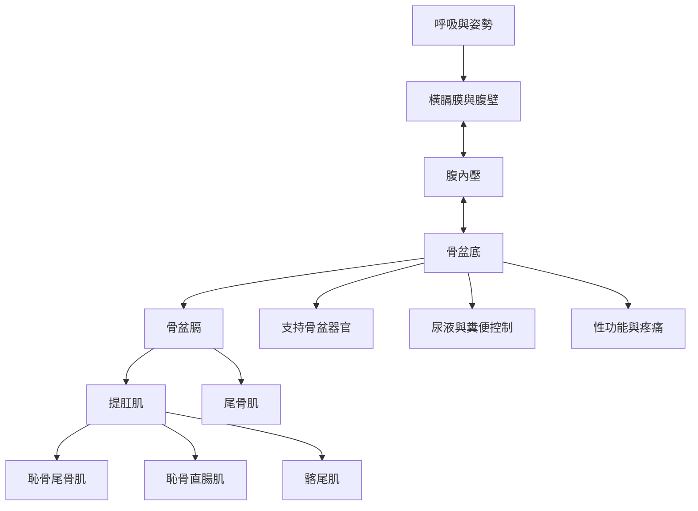

骨盆底是由多層肌肉與結締組織構成的動態支持系統。理解它需要把骨盆膈、提肛肌各部分、呼吸、腹內壓與器官功能放在同一張地圖中，而不是把「骨盆底」想成一個單一肌肉。

此地圖可連結[[骨盆底不是單一肌肉而是多組織協作的功能系統]]、[[呼吸與腹內壓管理會影響骨盆底負荷]]與[[骨盆底健康取決於力量放鬆與協調之間的可調節性]]。

概念入口：[[骨盆底]]、[[骨盆膈]]、[[提肛肌]]、[[恥骨尾骨肌]]、[[恥骨直腸肌]]、[[髂尾肌]]、[[尾骨肌]]、[[腹內壓]]。
