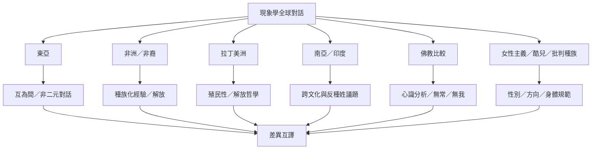

全球現象學不是將歐洲理論套用到各地經驗，而是追蹤概念如何被翻譯、抵抗與重構。東亞、非洲、拉丁美洲、印度與佛教思想提供不同的問題、歷史與方法；女性主義、酷兒與批判種族研究則提醒我們，經驗本身已受到權力關係塑造。

全球比較要避免把地區當成同質文化，也要區分學術現象學、在地哲學傳統與比較研究。延伸閱讀：[[東亞現象學透過互為間與非二元關係拓展傳統]]、[[非洲現象學從黑人存在與殖民處境拓展研究對象]]、[[拉丁美洲現象學與解放哲學的連結仍有內部爭論]]、[[現象學在印度的研究呈現跨文化與跨領域的新方向]]、[[阿毘達磨與胡塞爾現象學可比較但不可等同]]、[[跨文化對話應以差異互譯而非強行等同為方法]]。

收錄於全書導讀：[[phenomenology]]
