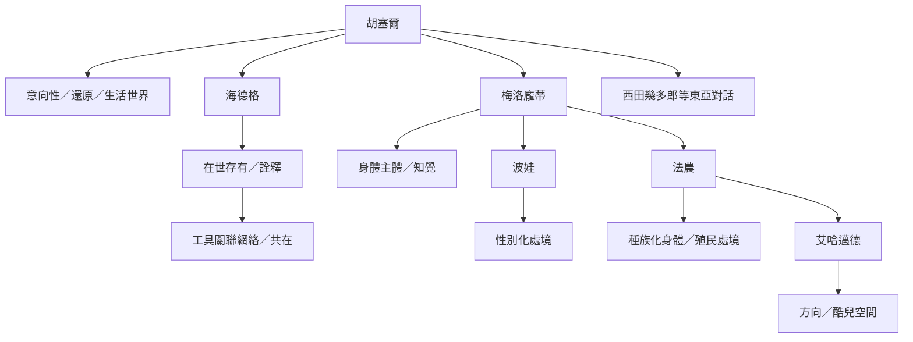

現象學不是單一路線。胡塞爾重視意向性、還原與生活世界；海德格將問題推向存在、在世存有與詮釋；梅洛龐蒂強調身體知覺；波娃與法農將性別、種族化與處境帶入經驗分析；艾哈邁德則進一步分析方向、空間與規範。

此圖呈現思想上的對話與影響，不表示所有思想家都接受相同方法或彼此有直接師承關係。延伸閱讀：[[海德格把現象學轉向此在的在世存有]]、[[世界首先以可使用的關聯網絡而非孤立物件顯現]]、[[胡塞爾以意向性與生活世界奠定現象學基礎]]、[[梅洛龐蒂把知覺理解為身體在世界中的參與]]、[[波娃將性別壓迫寫成具體生活經驗]]、[[非洲現象學從黑人存在與殖民處境拓展研究對象]]、[[酷兒現象學揭示身體方向如何被社會規範安排]]、[[東亞現象學透過互為間與非二元關係拓展傳統]]。

收錄於全書導讀：[[phenomenology]]
