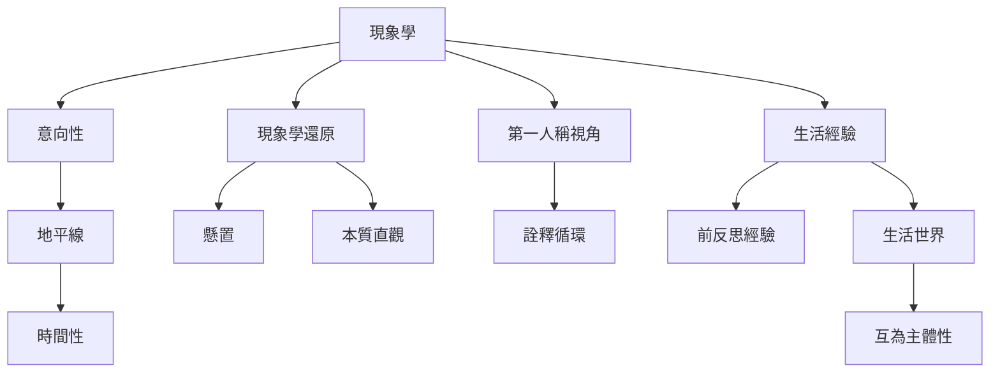

現象學的核心不是單一術語，而是經驗如何指向對象、如何在背景地平線中顯現，以及研究者如何暫緩預設來描述這個顯現。這張地圖把方法論概念與經驗結構放在同一個網絡中。

概念之間並非固定線性流程。研究者可能從具體[[生活經驗]]開始，發現其中的[[意向性]]與[[地平線]]，再檢查自身預設、進行[[現象學還原]]，並反覆修正描述。詳細定義見[[現象學]]、[[意向性]]、[[現象學還原]]、[[懸置]]、[[生活世界]]、[[第一人稱視角]]、[[生活經驗]]、[[本質直觀]]、[[地平線]]、[[時間性]]、[[前反思經驗]]與[[詮釋循環]]。

收錄於全書導讀：[[phenomenology]]
