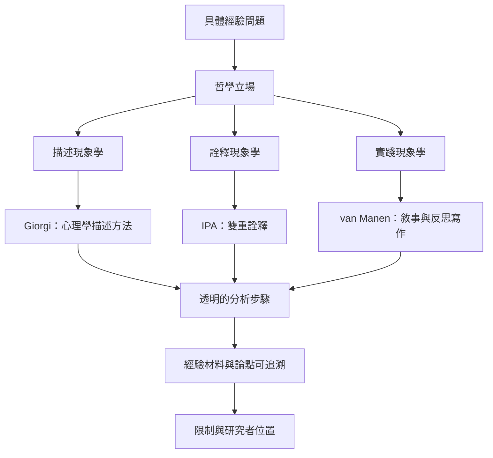

現象學研究從具體經驗出發，但不同方法對「描述」與「詮釋」的關係有不同立場。研究者應先提出經驗問題，再交代哲學路線、資料來源、分析步驟與研究者位置。

研究方法的名稱不能取代方法論論證。IPA 的詮釋承諾與描述現象學的還原程序並不相同；實踐現象學的寫作方式也受到學界批評。延伸閱讀：[[質性現象學研究需要明確交代其哲學承諾]]、[[詮釋現象學分析研究人如何理解重大生活經驗]]、[[生活經驗的敘事能支持實踐現象學的細緻分析]]、[[第一人稱資料不等於未經中介的真理]]、[[現象學研究的好問題從具體生活場景提出]]。

收錄於全書導讀：[[phenomenology]]
