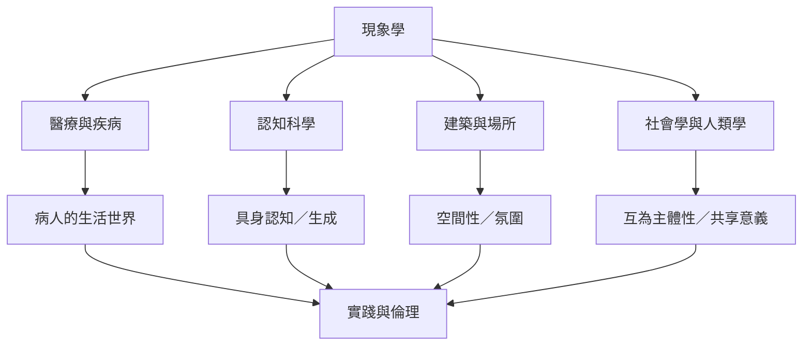

現象學的應用不是把哲學概念貼到不同專業上，而是用經驗結構重新提出該領域的問題。身體、空間、時間、社會互動與生活世界，可以連結醫療、認知科學、建築、教育、宗教研究和日常實踐。

跨領域運用應保留不同證據標準：醫療研究需兼顧臨床證據，認知科學需說明實驗與模型，社會研究需分析制度與權力。延伸閱讀：[[疾病經驗會重組身體與世界的關係]]、[[具身認知將第一人稱經驗帶回認知科學]]、[[建築現象學研究身體與環境如何共同形成意義]]、[[社會世界由共享意義與日常知識構成]]、[[宗教人類學透過參與觀察研究活生生的宗教經驗]]。

收錄於全書導讀：[[phenomenology]]
