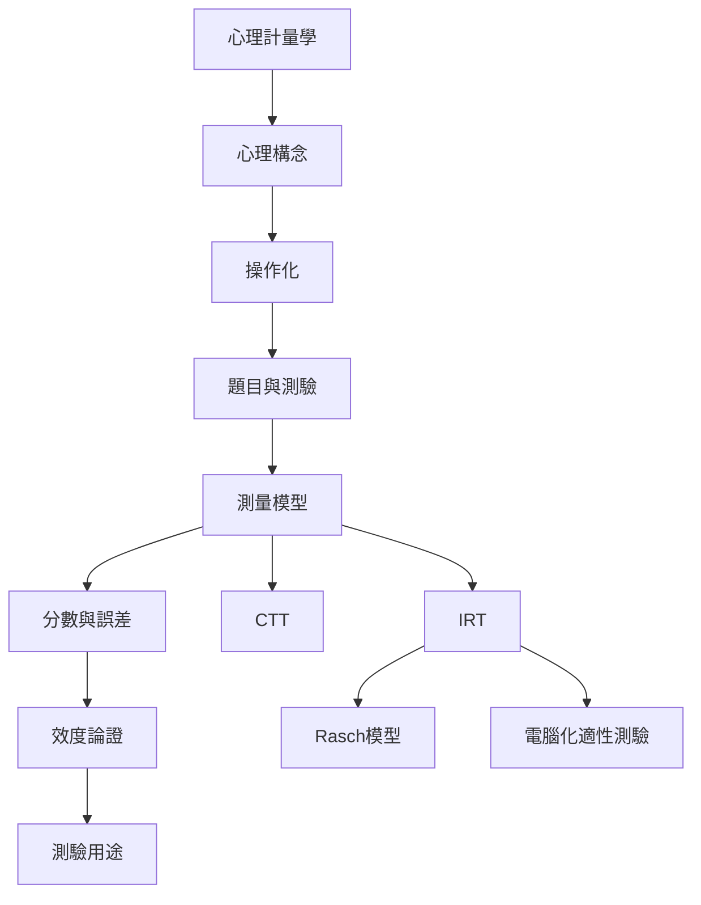

心理計量學把心理理論轉成可檢驗的測量程序，並透過統計模型解讀分數。這張地圖以「構念—操作化—測量—推論」為主線，提醒任何數字都需要說明其生成方式與解釋範圍。

## 關係圖

## 概念連結
[[心理計量學]]、[[心理構念]]、[[操作化]]、[[潛在變項]]、[[古典測驗理論]]、[[項目反應理論]]、[[Rasch模型]]、[[因素分析]]、[[信度]]、[[效度]]、[[測量誤差]]、[[標準測量誤差]]、[[量尺層級]]、[[測驗等化]]。

可搭配閱讀 [[心理計量學連結心理理論與統計推論]]、[[心理分數是操作化結果，不是心理本質本身]] 與 [[心理屬性的可量化性必須被檢驗]]。

全書導讀：[[psychometrics]]。

延伸脈絡：[[心理測驗常模]]。

延伸脈絡：[[心理測驗倫理]]。

延伸脈絡：[[測驗公平性]]。

延伸脈絡：[[測驗反應歷程]]。

延伸脈絡：[[內部一致性]]。

延伸脈絡：[[建構效度]]。

延伸脈絡：[[內容效度]]。

延伸脈絡：[[收斂與區辨證據]]。

延伸脈絡：[[測量恆等性]]。

延伸脈絡：[[差異試題功能]]。

延伸脈絡：[[電腦化適性測驗]]。

延伸脈絡：[[效標關聯證據]]。

延伸脈絡：[[反應風格]]。

延伸脈絡：[[本土心理學]]。

延伸脈絡：[[以認知訪談檢查題目在不同文化中的真實理解]]。

延伸脈絡：[[把心理分數改寫成有範圍的敘述而非人格標籤]]。

延伸脈絡：[[以多方法追蹤心理狀態而非依賴單次問卷]]。

延伸脈絡：[[為跨文化測驗比較建立共同治理的研究流程]]。

延伸脈絡：[[對 AI 量表測試建立跨提示與跨版本的穩定性檢查]]。

延伸脈絡：[[以心理量表研究台灣日常語言中的自在與壓力]]。

延伸脈絡：[[建立一份心理測量方法的可重現分析範本]]。

延伸脈絡：[[把量表的社會後果納入公開的測驗影響評估]]。

延伸脈絡：[[為每份量表建立一張測量護照]]。

延伸脈絡：[[為心理量表建立可查詢的全球證據地圖]]。

延伸脈絡：[[跨文化問卷的作答風格既是誤差也是文化行為]]。

延伸脈絡：[[標準化測驗導論整理古典測驗理論與項目反應理論]]。

延伸脈絡：[[Messick將效度整合為分數意義與社會後果的論證]]。

延伸脈絡：[[心理測驗的歷史需要同時檢視科學與權力]]。

延伸脈絡：[[COSMIN以內容效度為核心評估健康結果量表]]。

延伸脈絡：[[Cronbach alpha的普及不代表它適用於所有量表]]。

延伸脈絡：[[阿拉伯語心理測驗回顧揭示翻譯與驗證品質落差]]。

延伸脈絡：[[心理計量學手冊呈現量表開發的跨學科範圍]]。

延伸脈絡：[[跨文化自陳量表調適不能止於逐字翻譯]]。

延伸脈絡：[[測量恆等性是跨群體比較的前置條件]]。

延伸脈絡：[[非裔心理學者的測驗史回顧揭示種族主義脈絡]]。

延伸脈絡：[[測驗標準把效度視為分數解釋與使用的證據]]。

延伸脈絡：[[AI心理計量把人格量表用於大型語言模型]]。

延伸脈絡：[[WEIRD研究樣本提醒心理學不能把西方樣本當成人類代表]]。

延伸脈絡：[[2026人格跨文化回顧提醒平均數比較仍受等值性限制]]。

延伸脈絡：[[從 alpha 到 omega 提供內部一致性的替代估計]]。

延伸脈絡：[[心理計量學的發展同時來自個別差異與心理物理學]]。

延伸脈絡：[[量表開發指引要求從構念界定走向獨立驗證]]。

延伸脈絡：[[亞洲心理計量研究同時包含量表驗證與本土工具發展]]。

延伸脈絡：[[ITC測驗翻譯與調適指引建立國際專業基準]]。

延伸脈絡：[[心理測驗的數量化前提應接受測量理論檢驗]]。

延伸脈絡：[[測量恆等性決定群體比較的可解釋範圍]]。

延伸脈絡：[[效度是對分數解釋與使用提出的整體論證]]。

延伸脈絡：[[本土心理學需要能表達在地經驗的測量工具]]。

延伸脈絡：[[古典測驗理論把觀察分數拆成真分數與誤差]]。

延伸脈絡：[[信度描述分數精確度而非測驗的全部品質]]。

延伸脈絡：[[跨文化調適需要語言與概念兩層等值]]。

延伸脈絡：[[因素分析檢查題目如何共同變動]]。

延伸脈絡：[[項目反應理論以題目層次描述作答機率]]。

延伸脈絡：[[量表開發是一個反覆修正的研究流程]]。

延伸脈絡：[[心理測驗的歷史包含分類權力與優生學遺緒]]。

延伸脈絡：[[電腦化適性測驗依據即時資訊選題]]。

延伸脈絡：[[內容效度先問題目是否涵蓋目標經驗]]。

延伸脈絡：[[內部一致性不能取代量表的結構效度]]。

延伸脈絡：[[Rasch模型以特定測量要求檢查資料與量尺]]。

延伸脈絡：[[測量證據的地理分布也是知識公平問題]]。

延伸脈絡：[[心理量表的適用範圍不能超過驗證樣本的證據]]。

延伸脈絡：[[差異試題功能表示相同特質下題目對群體仍可能不同]]。

延伸脈絡：[[公平性是心理測驗效度的一部分]]。

延伸脈絡：[[反應風格會混入跨文化問卷的分數差異]]。

延伸脈絡：[[心理計量學領域的歷任領導者訪談呈現學科多元觀點]]。
