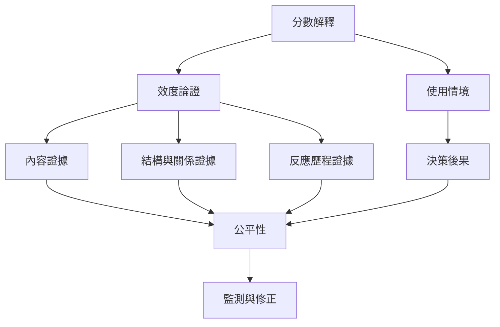

效度與公平不是兩套分開的檢查。當分數被用來分類、診斷或分配資源時，研究者必須檢查推論是否有充分證據、不同群體是否承受不相關的測量負擔，以及決策後果是否正當。

## 關係圖

## 概念連結
[[效度]]、[[建構效度]]、[[內容效度]]、[[效標關聯證據]]、[[收斂與區辨證據]]、[[測驗公平性]]、[[心理測驗倫理]]、[[差異試題功能]]。

核心筆記：[[效度是對分數解釋與使用提出的整體論證]]、[[公平性是心理測驗效度的一部分]]、[[心理測驗的歷史包含分類權力與優生學遺緒]]。

延伸脈絡：[[把心理分數改寫成有範圍的敘述而非人格標籤]]。

延伸脈絡：[[把量表的社會後果納入公開的測驗影響評估]]。

全書導讀：[[psychometrics]]。

延伸脈絡：[[心理計量學連結心理理論與統計推論]]。
