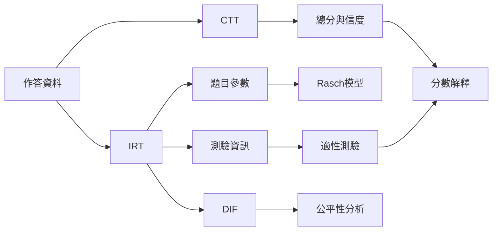

測量模型提供從觀察反應到潛在構念估計的規則。不同模型並非單純的新舊替代，而是有不同資料需求、假設與解釋層次；選擇模型時應回到研究問題與測量目的。

## 關係圖

## 概念連結
[[古典測驗理論]]、[[項目反應理論]]、[[Rasch模型]]、[[因素分析]]、[[信度]]、[[測量誤差]]、[[差異試題功能]]、[[電腦化適性測驗]]、[[測驗等化]]。

核心筆記：[[古典測驗理論把觀察分數拆成真分數與誤差]]、[[項目反應理論以題目層次描述作答機率]]、[[Rasch模型以特定測量要求檢查資料與量尺]]。

延伸脈絡：[[信度描述分數精確度而非測驗的全部品質]]。

延伸脈絡：[[內部一致性不能取代量表的結構效度]]。

延伸脈絡：[[電腦化適性測驗依據即時資訊選題]]。

延伸脈絡：[[以多方法追蹤心理狀態而非依賴單次問卷]]。

延伸脈絡：[[對 AI 量表測試建立跨提示與跨版本的穩定性檢查]]。

全書導讀：[[psychometrics]]。
