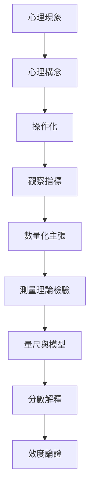

心理計量學的哲學問題，在於心理構念究竟以何種方式存在、是否具有數量結構，以及數字如何代表心理屬性的大小。這些問題不能只靠統計模型解決，還涉及理論定義、經驗證據與科學解釋。

## 關係圖

## 概念連結
[[心理計量學]]、[[心理構念]]、[[潛在變項]]、[[操作化]]、[[量尺層級]]、[[測量誤差]]、[[效度]]。

核心筆記：[[心理屬性的可量化性必須被檢驗]]、[[心理分數是操作化結果，不是心理本質本身]]、[[心理計量學連結心理理論與統計推論]]。

全書導讀：[[psychometrics]]。
