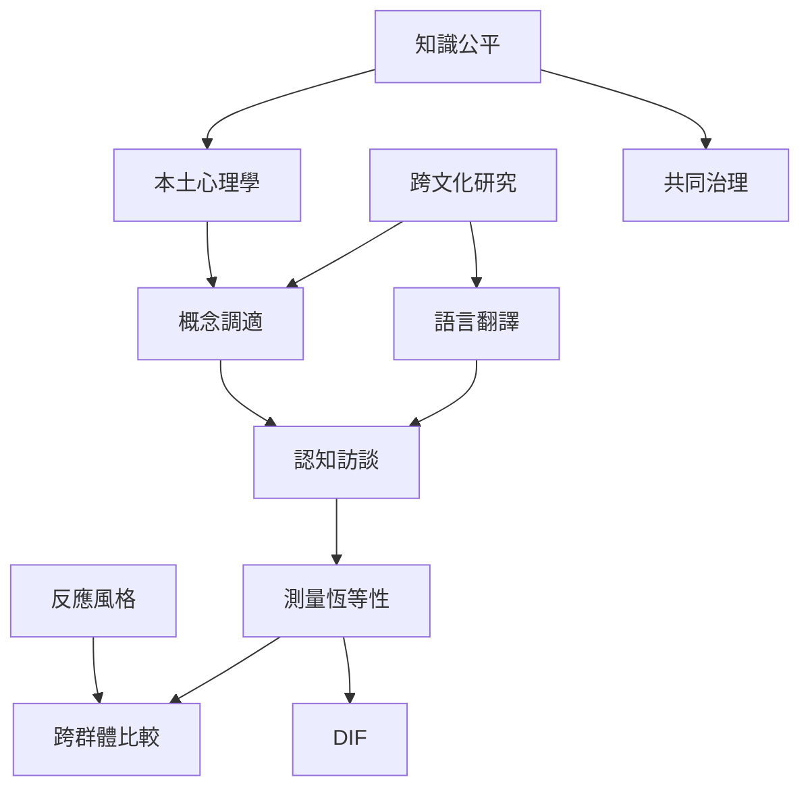

跨文化測量的關鍵不是把同一份題目翻成多種語言，而是檢驗不同語境中的題目意義、作答歷程與測量結構是否足以支持共同推論。全球研究需要同時關注測量技術與知識生產的權力分布。

## 關係圖

## 概念連結
[[測量恆等性]]、[[差異試題功能]]、[[反應風格]]、[[本土心理學]]、[[心理測驗常模]]、[[測驗公平性]]、[[心理測驗倫理]]。

核心筆記：[[跨文化調適需要語言與概念兩層等值]]、[[測量恆等性決定群體比較的可解釋範圍]]、[[本土心理學需要能表達在地經驗的測量工具]]、[[測量證據的地理分布也是知識公平問題]]。

延伸脈絡：[[反應風格會混入跨文化問卷的分數差異]]。

延伸脈絡：[[差異試題功能表示相同特質下題目對群體仍可能不同]]。

延伸脈絡：[[心理量表的適用範圍不能超過驗證樣本的證據]]。

延伸脈絡：[[以認知訪談檢查題目在不同文化中的真實理解]]。

延伸脈絡：[[以心理量表研究台灣日常語言中的自在與壓力]]。

延伸脈絡：[[為跨文化測驗比較建立共同治理的研究流程]]。

延伸脈絡：[[為心理量表建立可查詢的全球證據地圖]]。

全書導讀：[[psychometrics]]。
