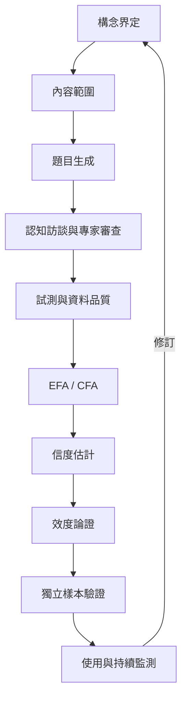

量表建構不是題目堆疊，而是由理論定義出發，經過內容取樣、受試者理解檢驗、因素結構與信度估計，再針對目標用途累積效度證據的迭代流程。

## 關係圖

## 概念連結
[[心理構念]]、[[操作化]]、[[內容效度]]、[[因素分析]]、[[內部一致性]]、[[信度]]、[[效度]]、[[測驗反應歷程]]、[[測量誤差]]。

核心筆記：[[量表開發是一個反覆修正的研究流程]]、[[內容效度先問題目是否涵蓋目標經驗]]、[[內部一致性不能取代量表的結構效度]]。

延伸脈絡：[[因素分析檢查題目如何共同變動]]。

延伸脈絡：[[為每份量表建立一張測量護照]]。

延伸脈絡：[[建立一份心理測量方法的可重現分析範本]]。

全書導讀：[[psychometrics]]。

延伸脈絡：[[心理計量學連結心理理論與統計推論]]。
