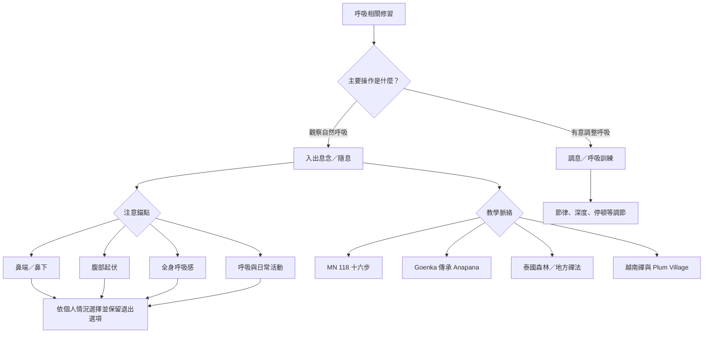

本圖比較修習錨點、注意範圍、操作方式與教學目的。它不做高下排名；不同方法可能服務不同傳承和學習階段。

## 方法卡片
- [[呼吸念以如實覺察而非控制呼吸為核心]]
- [[呼吸所緣的位置與方法會隨傳承而改變]]
- [[安般念與Goenka式Anapana在目標與架構上相關但不等同]]
- [[佛教隨息與調息可由是否主動改變呼吸來區別]]
- [[呼吸覺察也可能不適合所有人且需要可調整的入口]]

## 實驗構想
- [[用一週呼吸日誌辨認覺察何時滑向控制]]
- [[比較鼻端與腹部錨點時先固定觀察條件]]
- [[設計呼吸不適時可以退出的安全練習流程]]
- [[以散步觀息測試覺察能否離開坐墊]]

---

回到全書導讀：[[Ānāpānasati]]
