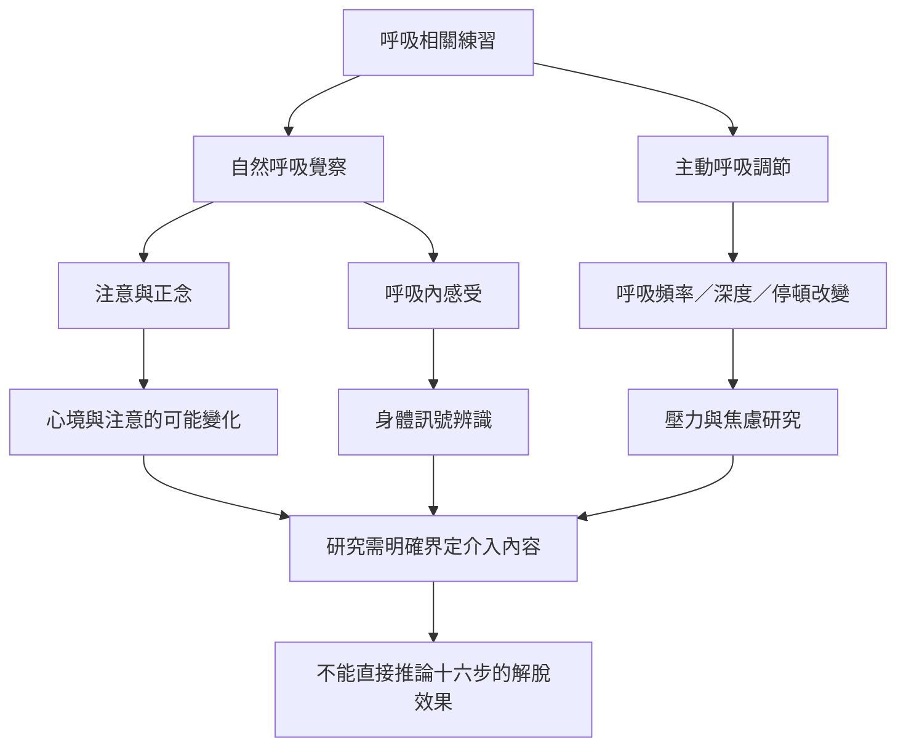

這張圖把佛教傳統中的自然呼吸覺察，與現代研究中的內感受、正念介入、呼吸調節與焦慮指標連結。請注意：心理學研究的操作型定義不等於佛教經典的修行目標。

## 研究來源
- [[早期佛教呼吸念不只是狹窄焦點注意力]]
- [[呼吸訊號內感受研究提出正念改善情緒的可能機制]]
- [[2024系統回顧指出短時呼吸介入效果依方法而異]]
- [[獨立正念練習的焦慮憂鬱效果呈小至中度]]
- [[調息型介入的研究證據不能直接代表自然呼吸觀]]

## 概念連結
- [[內感受是感知身體內部生理訊號的能力]]
- [[正念是記得並持續照看當下所緣的心智能力]]
- [[調息是有意識調整呼吸的身心技術]]
- [[正念呼吸的效果需要區分機制假說與臨床證據]]
- [[讓研究設計區分自然呼吸觀與節律調節]]

---

回到全書導讀：[[Ānāpānasati]]
